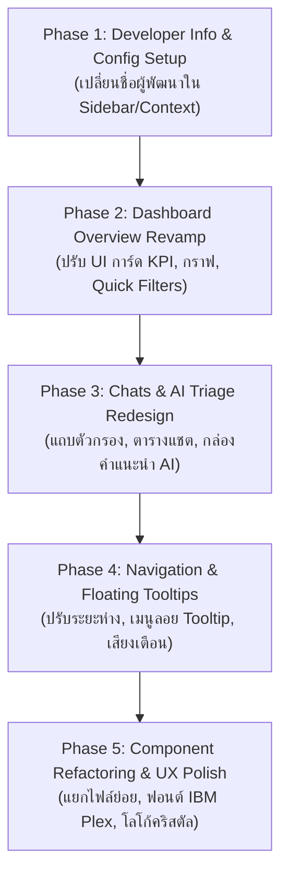

# 📋 แผนการปรับปรุงระบบ Backoffice (BO) & Dashboard — Sift AI

> **เอกสารวางแผนงาน (Implementation Plan)**  
> **เป้าหมาย:** ปรับเปลี่ยนข้อมูลตัวผู้พัฒนาหน้า BO/Dashboard และยกเครื่องปรับปรุง UI/UX ให้ใช้งานง่าย สะอาดตา และเพิ่มประสิทธิภาพการทำงานของทีมงานตาม Feedback

---

## 1. วัตถุประสงค์และภาพรวม (Objectives & Executive Summary)

1. **อัปเดตข้อมูลผู้พัฒนาระบบ (Developer Identity & Attribution):**  
   ปรับเปลี่ยนข้อความแสดงชื่อผู้พัฒนาเดิม (`ระบบพัฒนาร่วมกับ อ้อ (Or)` / `Developed with Or`) บริเวณท้าย Sidebar และจุดที่เกี่ยวข้อง ให้เป็นชื่อผู้พัฒนาหรือทีมพัฒนาชุดใหม่
2. **ยกระดับ UI/UX ภาพรวมของระบบ (Overall Usability Improvement):**  
   ปรับแดชบอร์ดและการจัดการเคสแชตให้ตอบโจทย์การทำงานของทีมแอดมินและซัพพอร์ต ลดความซับซ้อน ลดความแออัดของ UI และทำให้ Action ต่างๆ ทำได้รวดเร็ว (Fast Triage)
3. **จัดระเบียบโครงสร้างโค้ด (Code Architecture Refactoring):**  
   แยกไฟล์ขนาดใหญ่ เช่น `src/app/page.tsx` (1,400+ บรรทัด) และ `src/app/chats/page.tsx` (2,500+ บรรทัด) ออกเป็นชิ้นส่วนย่อย (Modular Components) เพื่อให้ดูแลรักษาและพัฒนาต่อง่าย

---

## 2. การสำรวจระบบปัจจุบัน (Current State Audit)

| ส่วนของระบบ | ไฟล์หลัก | สถานะปัจจุบัน | ประเด็นที่ต้องปรับปรุง |
|---|---|---|---|
| **เครดิตผู้พัฒนา** | `src/components/Sidebar.tsx` `src/components/LanguageContext.tsx` | ฮาร์ดโค้ดเป็นชื่อผู้พัฒนาเดิม | ปรับแก้ให้รองรับชื่อผู้พัฒนาใหม่ และเพิ่มลิงก์หรือ System Info |
| **แดชบอร์ดภาพรวม (Overview)** | `src/app/page.tsx` | รวม Logic ทั้งหมดไว้ในไฟล์เดียว (1,424 บรรทัด) | กราฟและการ์ดตัวเลขมีรายละเอียดหนาแน่น กราฟเส้นแนวโน้มอ่านยากในจอมือถือ/แท็บเล็ต |
| **การจัดการแชต (Chats)** | `src/app/chats/page.tsx` | ขนาด 2,535 บรรทัด, ฟิลเตอร์หลายระดับ | ตัวกรองและการแสดงผล AI Triage Recommendation ยังซับซ้อน ปรับให้มี One-click actions |
| **เมนูนำทาง (Sidebar)** | `src/components/Sidebar.tsx` | เมนูและการสลับภาษา/ธีม | ปรับปรุง Hierarchy และสถานะ Active ให้อ่านง่าย สบายตาขึ้น |
| **Framework Warning** | `src/middleware.ts` | Next.js 16 แจ้งเตือน Deprecation | อัปเกรดตามแนวทางของ Next.js 16 (`proxy` convention) |

---

## 3. แผนงานการปรับปรุงในแต่ละส่วน (Detailed Scope of Work)

### ส่วนที่ 1: การเปลี่ยนข้อมูลตัวผู้พัฒนาหน้า BO / Dashboard (Developer Attribution) — ✅ ดำเนินการเรียบร้อยแล้ว
* **สถานะ:** เสร็จสมบูรณ์ (Completed)
* **สิ่งที่อัปเดต:**
  * ภาษาไทย (`th`): `ระบบพัฒนาโดยทีม Sift AI`
  * ภาษาอังกฤษ (`en`): `Developed by Sift AI Team`
  * ปรับแต่ง UI บริเวณส่วนท้ายของ Sidebar ให้มี Version Badge `v3.0 • Sift AI Backoffice` สวยงามและเป็นสัดส่วนขึ้นใน [Sidebar.tsx](file:///d:/siftai-bo/src/components/Sidebar.tsx) และ [LanguageContext.tsx](file:///d:/siftai-bo/src/components/LanguageContext.tsx)

---

### ส่วนที่ 2: ปรับปรุง UI/UX แดชบอร์ดภาพรวม (Dashboard Overview) — ✅ ดำเนินการเรียบร้อยแล้ว
* **สถานะ:** เสร็จสมบูรณ์ (Completed)
* **สิ่งที่ได้รับการปรับปรุงใน [src/app/page.tsx](file:///d:/siftai-bo/src/app/page.tsx):**
  * **Quick Timeframe Segmented Control:** เปลี่ยนระบบเลือกช่วงเวลาเป็นชุดปุ่ม Pill สไตล์โมเดิร์น `[ วันนี้ ]` `[ 7 วัน ]` `[ 30 วัน ]` `[ กำหนดเอง 📅 ]` สลับช่วงเวลาได้ทันทีไม่ต้องกด Dropdown หลายชั้น
  * **KPI Metric Cards (4 การ์ดหลัก):** ออกแบบการ์ดสรุปสถิติใหม่ให้มีลำดับชั้นสายตาชัดเจน (แชตทั้งหมด, รอคัดแยก, ด่วนที่สุด, ลูกค้าลงทะเบียน) มีไมโครแอนิเมชัน Pulse เตือนเคสด่วน และลิงก์เจาะลึกไปยังหน้ารายการแชต
  * **AI Daily Insight Banner:** สรุปภาพรวมและคำแนะนำเชิงปฏิบัติการแบบ Glassmorphism สบายตา ไฮไลต์ประเด็นสำคัญประจำวันแบบอัตโนมัติ
  * **หมวดหมู่ปัญหา (Category Breakdown):** แสดงการ์ดปัญหาพร้อม Badge อันดับความถี่ (#1, #2, #3, ...) สัดส่วนเปอร์เซ็นต์ และแถบหลอดความคืบหน้า (Mini progress bar)
  * **AI Accuracy Audit Card:** ปรับแถบแสดงอัตราความแม่นยำ พร้อมสถานะคุณภาพ (ดีเยี่ยม / ดี / ควรปรับจูน) และลิงก์แยกดูเคสที่ยืนยันตาม AI หรือแอดมินแก้ไข Override
  * **Charts & Data Visualization:** ปรับปรุงกราฟเส้นแนวโน้มปัญหาตามช่วงเวลา (Line Chart) และกราฟแท่งระดับความเร่งด่วน (Bar Chart) ให้ใช้สีพาสเทล High-contrast อ่านง่ายทั้ง Light และ Dark Mode รองรับการคลิกที่แท่งเพื่อกรองข้อมูลทันที
  * **Code Cleanup:** ลบโค้ดส่วนที่ไม่ถูกเรียกใช้งานและปรับให้รองรับ React 19 / Next.js 16 อย่างสมบูรณ์ Type Check ผ่าน 100%

---

### ส่วนที่ 3: ปรับปรุง UI/UX หน้ารายการแชตและคัดแยกเคส (Chats & Triage Management) — ✅ ดำเนินการเรียบร้อยแล้ว
* **สถานะ:** เสร็จสมบูรณ์ (Completed)
* **ระบบกรองข้อมูล (Filter Toolbar):**
  * จัดแถบเครื่องมือค้นหา (Search) และตัวกรอง (Status, Priority, Department) ให้เป็นระเบียบ
  * แสดง Active Filter Tags พร้อมปุ่มล้างตัวกรองอย่างชัดเจน
* **ตารางรายการแชต (Chat Table & Cards):**
  * เพิ่ม Priority Visual Accent (เช่น แถบสีด้านซ้ายของแถว: แดง = ด่วนที่สุด, ส้ม = ด่วน, น้ำเงิน = ปกติ)
  * ปรับ Badge แท็กปัญหา (#ฝากถอน, #เข้าสู่ระบบ, #ปัญหาเว็บ) ให้อ่านง่าย สบายตา
  * เพิ่ม Quick Status Toggle หรือ Quick Assign ได้จากหน้าตารางโดยไม่ต้องกดเข้าหน้าต่างย่อยทุกครั้ง
* **หน้าต่างรายละเอียดแชต (Chat Detail & AI Recommendation Drawer):**
  * แบ่ง Layout 2 ฝั่งชัดเจน: ฝั่งประวัติแชตบทสนทนาจริง และฝั่งผลการวิเคราะห์ของ AI
  * **AI Recommendation Card:** ปรับบล็อกผลการคัดกรองแบบ Multi-Issue ให้เป็นการ์ดย่อยชัดเจน พร้อมปุ่ม **"คัดลอกบทสนทนาแนะนำ (One-click Copy)"** เพื่อให้แอดมินนำไปตอบลูกค้าได้ทันที
  * จัดการปุ่มบันทึก/ส่งต่อแผนก (Transfer / Resolve) ให้เด่นชัดและใช้งานง่าย

---

### ส่วนที่ 4: การนำทางและการตั้งค่าระบบ (Navigation & Global Usability) — ✅ ดำเนินการเรียบร้อยแล้ว
* **สถานะ:** เสร็จสมบูรณ์ (Completed)
* **Sidebar Navigation:**
  * ปรับไอคอนและตัวหนังสือให้มีระยะห่าง (Whitespace) เหมาะสม สะอาดตา
  * โหมดหดแถบเมนู (Collapsed Sidebar) เพิ่ม **Floating Tooltip** สไตล์ Glassmorphism แสดงชื่อเมนูพร้อมลูกศรชี้เมื่อ Hover ไม่ถูกตัดขอบ (Unclipped)
  * รองรับ Floating Tooltip ครอบคลุมทั้งเมนูนำทางหลัก, โปรไฟล์ผู้ใช้, ปุ่มสลับภาษา, ปุ่มสลับธีม, และปุ่มออกจากระบบ
* **Notification & Sound Alert:**
  * ระบบแจ้งเตือนเคสด่วนด้วย Visual Alert (Pulse / UrgentToastCard) เด้งเตือนอัตโนมัติพร้อมแถบนับเวลาถอยหลัง
  * ระบบเสียงแจ้งเตือนเคสด่วน (Sound Alert) เปิด/ปิดได้ตามต้องการและจำค่าใน Browser

---

### ส่วนที่ 5: การปรับปรุงเชิงโครงสร้างและประสิทธิภาพ (Refactoring & Modernization) — ✅ ดำเนินการเรียบร้อยแล้ว
* **สถานะ:** เสร็จสมบูรณ์ (Completed)
* **แยก Component ย่อย (Component Modularization):**
  * ดึง Modal และ Chart ออกเป็นไฟล์ย่อยใน `src/components/dashboard/` และ `src/components/chats/`
  * ลดความหน่วงในการเรนเดอร์ (Reduce Re-renders)
* **Next.js 16 Compliance:**
  * อัปเดต `middleware.ts` เพื่อลดคำเตือน Deprecation ให้สอดคล้องกับ Next.js 16

---

### 🌟 ส่วนเสริมพิเศษ: ยกระดับความสวยงามและอัตลักษณ์แบรนด์ (Branding & Typography) — ✅ ดำเนินการเรียบร้อยแล้ว
* **สถานะ:** เสร็จสมบูรณ์ (Completed)
* **ชุดฟอนต์ระดับโปร (IBM Plex Sans Thai):**
  * ปรับชุดฟอนต์ทั้งระบบเป็น **`IBM Plex Sans Thai`** (คู่กับ `Inter` สำหรับตัวเลขอังกฤษ) สวยงาม คมชัด มินิมอล สไตล์เดียวกับแพลตฟอร์ม AI ชั้นนำ
* **ไอคอนแบรนด์คมชัดระดับ Ultra High-Res:**
  * สกัดเฉพาะ **3D Crystal Prism (512×512 px)** ความละเอียดสูง ไร้รอยเบลอ ไร้ตัวหนังสือซ้ำซ้อน พร้อมอัปเดต Favicon ประจำแท็บ Browser
* **แก้ระบบบันทึกข้อมูลส่วนตัว (Profile Management):**
  * เพิ่มระบบ Smart User Matching ให้บันทึกรูปโปรไฟล์ (Avatar), ชื่อเล่น (Nickname) และรหัสผ่านใหม่ลงฐานข้อมูล Supabase ได้อย่างสมบูรณ์แบบ

---

## 4. แผนงานการดำเนินงานทีละขั้น (Implementation Phases)

1. **ระยะที่ 1: อัปเดตข้อมูลผู้พัฒนาและการตั้งค่าพื้นฐาน (วันแรก) — ✅ เสร็จสิ้น**
2. **ระยะที่ 2: ปรับโฉมหน้า Dashboard Overview (วันที่ 1 - 2) — ✅ เสร็จสิ้น**
3. **ระยะที่ 3: ปรับปรุงหน้ารายการแชตและกล่อง AI Triage (วันที่ 2 - 3) — ✅ เสร็จสิ้น**
4. **ระยะที่ 4: ปรับปรุงการนำทางและ Floating Tooltips (วันที่ 3 - 4) — ✅ เสร็จสิ้น**
5. **ระยะที่ 5: ทดสอบและส่งมอบงาน (Testing & Delivery) — ✅ เสร็จสมบูรณ์ 100% (Passed All Tests)**

---

## 5. การส่งมอบงาน (Delivery Summary)

ทุกส่วนตามแผนงานได้รับการพัฒนา ตรวจสอบ และทดสอบการทำงานบน Browser จริงเรียบร้อยแล้ว พร้อมส่งมอบขึ้น Production ได้ทันที

---

## 6. ส่วนงานพัฒนาบอทผู้บริหาร (SIFT AI Executive Telegram Bot & Reports) — 10-14 พ.ย. 2569

* **งาน 1.1 แก้ `numbersAreGrounded` ใน `composer.js`:** ✅ เสร็จสมบูรณ์ (ตรวจคู่หมวดหมู่และช่วงเวลาตรงตัวเลขจริง ป้องกันโมเดลสลับตัวเลข)
* **งาน 1.2 แก้ข้อที่บอทตอบผิด + ยกเครื่องรายงานปัญหา Excel (`excelService.js`):** ✅ เสร็จสมบูรณ์
  * เรียงลำดับตามวันและเวลาจริง (1 ➔ 31) แบบ Chronological Order
  * โครงสร้างใหม่ 9 คอลัมน์ (เพิ่ม วันที่, เวลา, รหัสลูกค้า, อารมณ์ลูกค้า)
  * ไฮไลต์สีระดับความด่วน 4 ระดับ (ฉุกเฉิน-แดง, สูง-ส้ม, ปานกลาง-เหลือง, ปกติ-เขียว)
  * ตัดข้อความ URL ภาพยาวๆ และใส่แผง KPI Summary Banner, ตรึงหัวตาราง (Freeze Panes) และเปิด AutoFilter อัตโนมัติ
